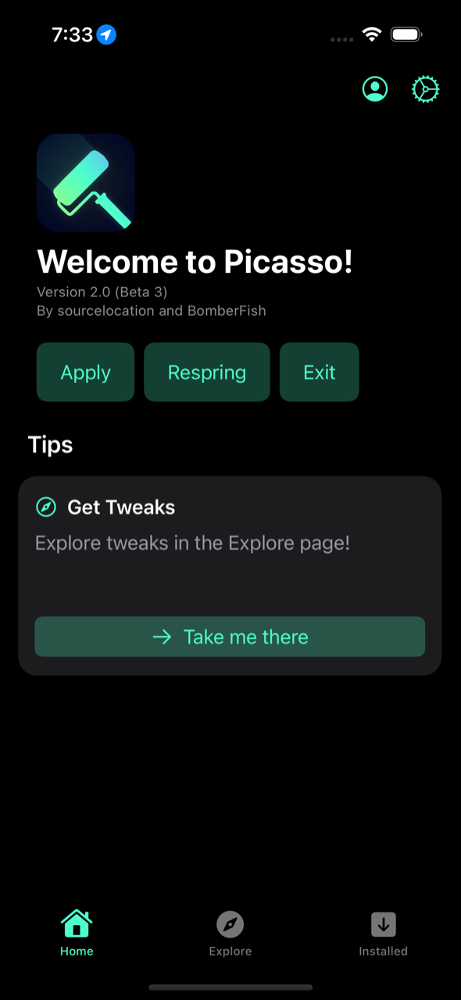
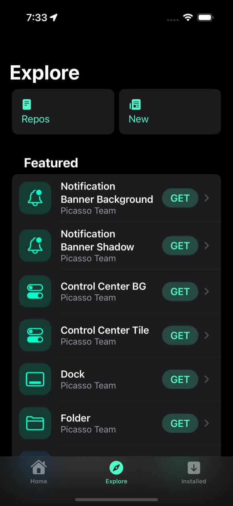
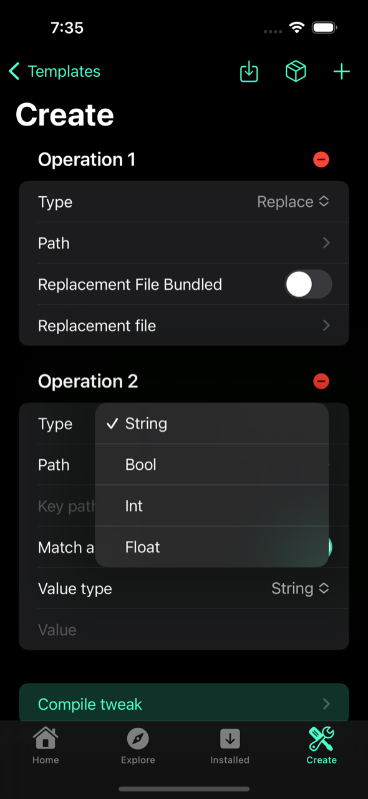
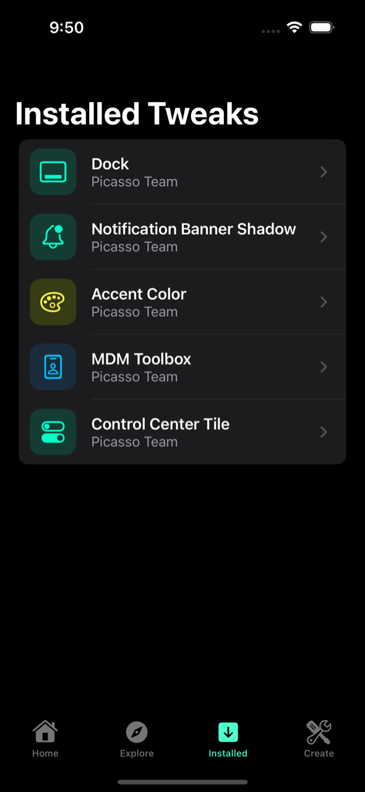

  

<h1 align="center">Picasso</h1>

  A jailed toolbox for all arm64e iPhones on iOS 15.0 – 16.6 beta 1, using the KFD exploit and TrollStore 2.

  
  
  
  

## Features

- Easy to use TrollStore 2 installer
- Filesystem tweak editor
- Dynamic Island on any device
- Custom colors for the Dock, folder backgrounds, Control Center background, notification banners and notification shadows
- System-wide custom accent colors (instead of blue)
- MDM Toolbox
- User-made repositories

## Supported iOS versions

- iOS 15.0 – 15.7.1
- iOS 16.0 – 16.5
- iOS 16.6 beta 1

<b>Supported devices</b>

- iPhone XR
- iPhone XS
- iPhone XS Max
- iPhone 11
- iPhone 11 Pro
- iPhone 11 Pro Max
- iPhone SE (2nd generation)
- iPhone 12
- iPhone 12 mini
- iPhone 12 Pro
- iPhone 12 Pro Max
- iPhone 13
- iPhone 13 mini
- iPhone 13 Pro
- iPhone 13 Pro Max
- iPhone SE (3rd generation)
- iPhone 14
- iPhone 14 Plus
- iPhone 14 Pro
- iPhone 14 Pro Max

